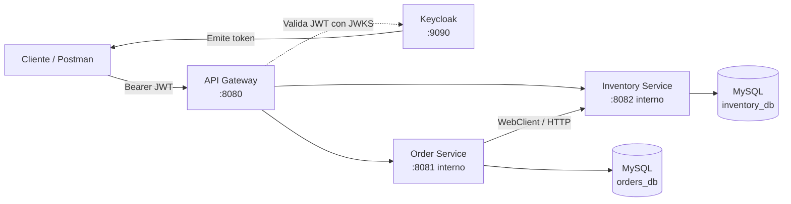

# Practice MicroService — API reactiva de pedidos e inventario

Proyecto backend desarrollado como práctica de **arquitectura de microservicios con Java y Spring Boot**. Implementa una API REST para consultar productos, verificar disponibilidad de inventario y gestionar pedidos, utilizando programación reactiva, autenticación JWT y contenedores Docker.

> **Propósito:** proyecto personal de aprendizaje. Su configuración está destinada a ejecutarse **localmente** y no está preparada para producción.

## ¿Qué permite hacer?

- Consultar productos y comprobar si existe stock suficiente para un pedido.
- Crear pedidos después de validar su disponibilidad en el servicio de inventario.
- Consultar pedidos y su historial de cambios de estado.
- Cancelar pedidos confirmados.
- Repetir un pedido anterior, conservando sus productos o modificando únicamente las cantidades.
- Proteger las rutas `/api/**` del API Gateway mediante tokens JWT emitidos por Keycloak.
- Registrar y propagar un identificador `X-Trace-Id` entre servicios para facilitar el seguimiento de las solicitudes.

## Arquitectura



| Componente | Responsabilidad |
| --- | --- |
| **API Gateway** | Punto de entrada público; enruta peticiones, valida JWT y asigna `X-Trace-Id`. |
| **Order Service** | Crea, consulta, cancela y repite pedidos; almacena ítems e historial de estados. |
| **Inventory Service** | Consulta productos y comprueba disponibilidad de stock. |
| **Keycloak** | Proporciona autenticación OAuth 2.0/OpenID Connect y emite JWT. |
| **MySQL** | Mantiene bases de datos separadas para pedidos e inventario. |

El servicio de pedidos se comunica con el de inventario mediante **Spring WebClient**. Cada servicio dispone de su propia base de datos, evitando compartir tablas directamente entre microservicios.

## Tecnologías utilizadas

| Tecnología | Uso / versión configurada |
| --- | --- |
| Java | 21 |
| Spring Boot | 4.1.1 |
| Spring WebFlux | API reactiva con `Mono` y `Flux` |
| Spring Cloud Gateway | Enrutamiento reactivo; BOM Spring Cloud 2025.1.3 |
| Spring Security + OAuth2 Resource Server | Validación de JWT |
| Keycloak | 26.8.0 |
| Spring Data R2DBC + R2DBC MySQL | Acceso reactivo a bases de datos |
| MySQL | 8.0 |
| Docker y Docker Compose | Construcción y ejecución local de los servicios |
| Maven | Gestión de dependencias y compilación |
| JUnit 5, Mockito y Reactor Test | Pruebas automatizadas incluidas en el proyecto |

## Estructura del proyecto

```text
Practice-MicroService/
├── gateway-service/       # API Gateway, seguridad y trazabilidad
├── inventory-service/     # Productos y disponibilidad de inventario
├── order-service/         # Pedidos, recompra e historial
├── keycloak/
│   └── realm-export.json  # Realm y cliente de desarrollo
├── docker-compose.yml     # Orquestación de todos los servicios
└── .gitignore
```

Cada microservicio incluye su propio `pom.xml`, `Dockerfile` y código fuente.

## Requisitos previos

Para utilizar la opción recomendada de Docker:

- **Docker Desktop** con el motor de Docker activo.
- **Docker Compose v2** (comando `docker compose`).
- **Postman** o cualquier cliente HTTP para probar la API.

No es necesario instalar Java ni Maven en el equipo para el arranque mediante Docker, porque los `Dockerfile` compilan y ejecutan las aplicaciones dentro de contenedores.

## Ejecución local con Docker

### 1. Clonar el repositorio

```bash
git clone https://github.com/AlonsoVillafan/Practice-MicroService.git
cd Practice-MicroService
```

### 2. Construir e iniciar los contenedores

```bash
docker compose up --build -d
```

Compose inicia dos instancias de MySQL, Inventory Service, Order Service, Keycloak y API Gateway. Keycloak importa la configuración ubicada en `keycloak/realm-export.json`.

### 3. Comprobar los contenedores

```bash
docker compose ps
```

Para consultar los registros de un servicio:

```bash
docker compose logs -f gateway-service
```

> En el primer arranque, las bases de datos y Keycloak pueden necesitar unos instantes para inicializarse. Si una petición falla al principio, comprueba que todos los servicios estén listos.

### 4. Acceder a los servicios

| Servicio | Dirección desde el equipo anfitrión |
| --- | --- |
| API Gateway | `http://localhost:8080` |
| Keycloak | `http://localhost:9090` |
| Realm | `http://localhost:9090/realms/reto-api` |

Order Service (`8081`) e Inventory Service (`8082`) **solo se exponen dentro de la red de Docker** en la configuración actual. Las peticiones externas deben realizarse mediante el API Gateway en el puerto `8080`.

### 5. Detener el entorno

```bash
docker compose down
```

Los volúmenes conservan los datos. Para eliminar **también** las bases de datos de prueba y comenzar desde cero:

```bash
docker compose down -v
```

**Atención:** `down -v` elimina los datos almacenados en los volúmenes de este proyecto.

## Autenticación con Keycloak

El Gateway exige un **Bearer Token JWT** para todas las rutas `/api/**`. El realm configurado es `reto-api`, y el cliente de prueba es `reto-api-client`.

El cliente tiene habilitadas las **cuentas de servicio** (`client_credentials`). No está habilitado el inicio de sesión directo mediante contraseña de usuario (`password` grant).

### Obtener un token con Postman

1. Crea una solicitud **POST** a:

   `http://localhost:9090/realms/reto-api/protocol/openid-connect/token`

2. En **Body → x-www-form-urlencoded**, ingresa:

   | Key | Value |
   | --- | --- |
   | `grant_type` | `client_credentials` |
   | `client_id` | `reto-api-client` |
   | `client_secret` | Secreto de desarrollo configurado en `keycloak/realm-export.json` |

3. Envía la solicitud y copia el campo `access_token` de la respuesta.
4. Para consumir la API, abre **Authorization → Bearer Token** en Postman y pega el token.

En cada petición protegida se enviará una cabecera similar a:

```http
Authorization: Bearer <ACCESS_TOKEN>
```

> Las credenciales incluidas en este repositorio son exclusivamente de **prueba local**. No las reutilices ni expongas estos servicios con dicha configuración en un entorno público.

## Endpoints de la API

Todas las rutas siguientes se consumen mediante `http://localhost:8080` y requieren un token JWT válido.

### Inventory Service

| Método | Endpoint | Descripción |
| --- | --- | --- |
| `GET` | `/api/inventory/health` | Comprueba que el servicio responde. |
| `GET` | `/api/inventory/products/{productId}` | Consulta un producto por su identificador. |
| `POST` | `/api/inventory/availability` | Verifica disponibilidad para uno o varios productos. |

**Consultar un producto**

```http
GET http://localhost:8080/api/inventory/products/P001
Authorization: Bearer <ACCESS_TOKEN>
```

**Verificar disponibilidad de productos**

```http
POST http://localhost:8080/api/inventory/availability
Authorization: Bearer <ACCESS_TOKEN>
Content-Type: application/json
```

```json
{
  "items": [
    { "productId": "P001", "quantity": 1 },
    { "productId": "P002", "quantity": 2 }
  ]
}
```

La respuesta indica si **todos** los productos solicitados tienen stock suficiente e incluye el detalle por ítem.

**Datos iniciales de prueba:**

| ID | Producto | Stock inicial |
| --- | --- | ---: |
| `P001` | Laptop | 10 |
| `P002` | Mouse | 25 |
| `P003` | Monitor | 0 |

Estos registros están definidos en `inventory-service/src/main/resources/data.sql`.

### Order Service

| Método | Endpoint | Descripción |
| --- | --- | --- |
| `POST` | `/api/orders` | Crea un pedido (si existe stock suficiente). |
| `GET` | `/api/orders/{id}` | Consulta un pedido por ID. |
| `GET` | `/api/orders/{id}/history` | Consulta el historial de estados. |
| `POST` | `/api/orders/{id}/cancel` | Cancela un pedido confirmado. |
| `POST` | `/api/orders/{id}/reorder` | Genera un nuevo pedido a partir de uno existente. |

**Crear un pedido**

```http
POST http://localhost:8080/api/orders
Authorization: Bearer <ACCESS_TOKEN>
Content-Type: application/json
```

```json
{
  "items": [
    { "productId": "P001", "quantity": 1 },
    { "productId": "P002", "quantity": 2 }
  ]
}
```

Si la disponibilidad es suficiente, se registra el pedido y pasa de `PENDING` a `CONFIRMED`. El servicio guarda ambos cambios en su historial.

**Consultar un pedido y su historial**

```http
GET http://localhost:8080/api/orders/1
Authorization: Bearer <ACCESS_TOKEN>
```

```http
GET http://localhost:8080/api/orders/1/history
Authorization: Bearer <ACCESS_TOKEN>
```

**Cancelar un pedido confirmado**

```http
POST http://localhost:8080/api/orders/1/cancel
Authorization: Bearer <ACCESS_TOKEN>
```

**Repetir un pedido**

```http
POST http://localhost:8080/api/orders/1/reorder
Authorization: Bearer <ACCESS_TOKEN>
```

Si no se envía cuerpo, se copian los productos y las cantidades del pedido original. Opcionalmente, se puede enviar un JSON con los **mismos productos** y nuevas cantidades; no se permite añadir o quitar productos en esa operación.

### Estados de los pedidos

| Estado | Significado |
| --- | --- |
| `PENDING` | Pedido creado, pendiente de confirmación durante el flujo de registro. |
| `CONFIRMED` | Pedido confirmado después de validar la disponibilidad. |
| `CANCELLED` | Pedido cancelado desde el estado `CONFIRMED`. |

## Manejo de errores y trazabilidad

Order Service centraliza varias respuestas de error, como:

- `400 Bad Request`: datos inválidos o solicitud de recompra no permitida.
- `404 Not Found`: pedido inexistente.
- `409 Conflict`: stock insuficiente o transición de estado no permitida.

El Gateway genera un identificador `X-Trace-Id` cuando la petición no lo proporciona; lo incorpora a la respuesta y lo propaga hacia los microservicios. Esto ayuda a relacionar los logs de una misma solicitud.

## Pruebas automatizadas

El código incluye pruebas de los servicios con **JUnit 5**, **Mockito** y **Reactor Test (`StepVerifier`)**, por ejemplo, para verificar el rechazo de pedidos con stock insuficiente y la recompra de un pedido existente.

Para ejecutar pruebas mediante Maven se deben tener configuradas las dependencias necesarias para cada prueba (algunas pruebas de arranque de contexto pueden requerir acceso a la base de datos).

## Alcance actual y posibles mejoras

Este es un proyecto de aprendizaje, por lo que tiene límites intencionales:

- **La disponibilidad de stock se consulta, pero no se descuentan ni reservan unidades** al confirmar un pedido.
- No se implementa todavía una coordinación transaccional distribuida entre pedidos e inventario.
- La protección JWT se implementa en el API Gateway; los microservicios internos no están publicados directamente al equipo anfitrión mediante Compose.
- Las credenciales y la configuración de Keycloak son para desarrollo local y deben reforzarse antes de cualquier despliegue real.

Entre las mejoras futuras se encuentran el descuento o reserva de stock, más pruebas de integración, documentación OpenAPI/Swagger y una configuración segura por entornos.

## Autor

**[AlonsoVillafan](https://github.com/AlonsoVillafan)**

Repositorio: [Practice-MicroService](https://github.com/AlonsoVillafan/Practice-MicroService)

---

*Primer proyecto personal de microservicios desarrollado para practicar Spring Boot, programación reactiva, APIs REST, seguridad JWT y Docker.*
